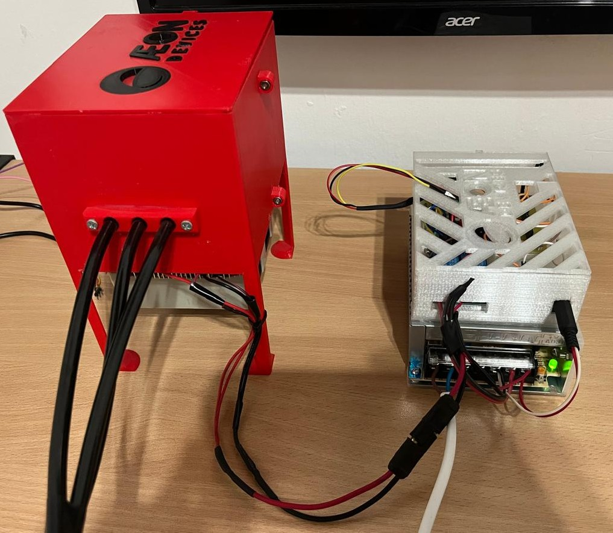
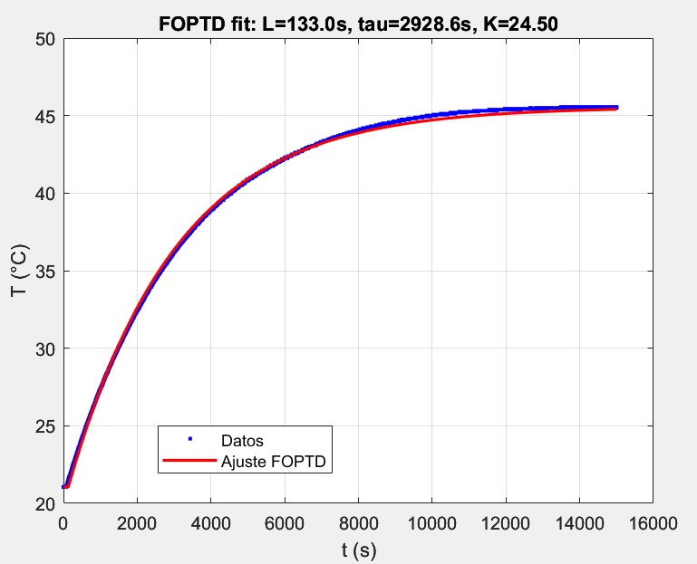
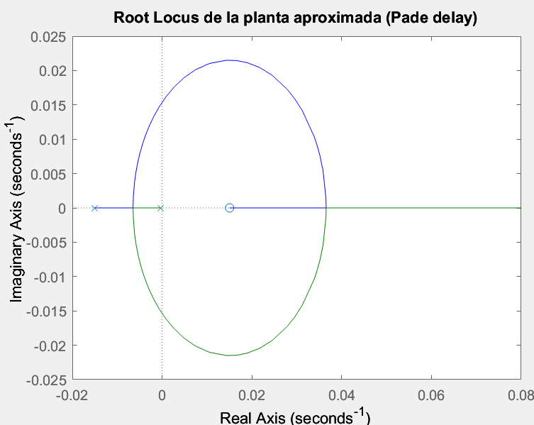
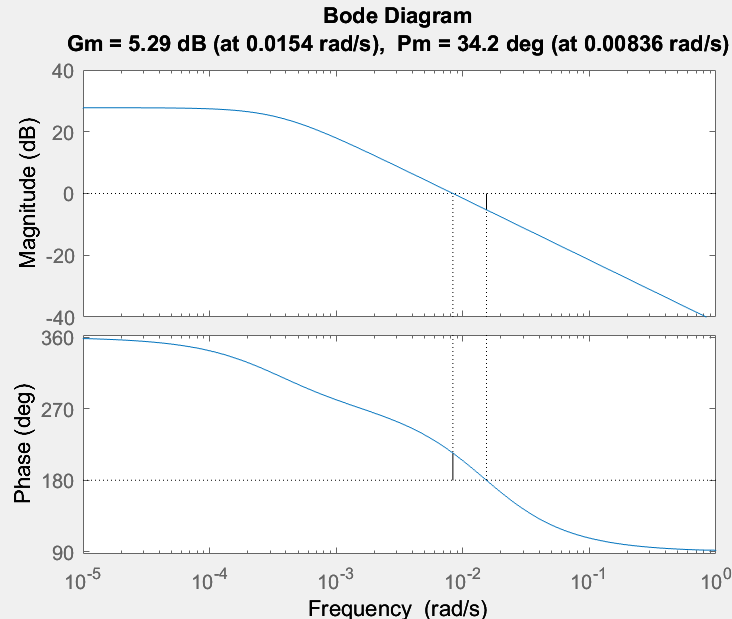
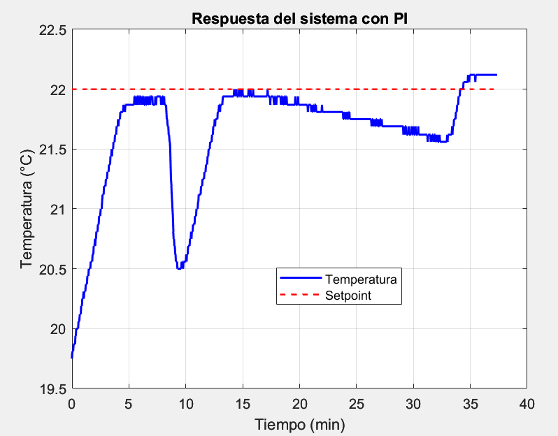
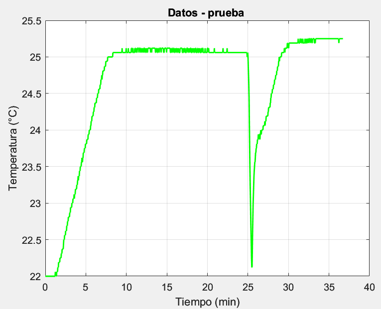
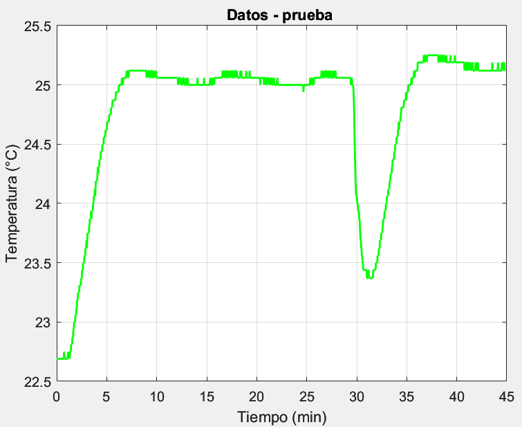

# Cámara de cultivo de hongos — control de temperatura con ESP32

Subsistema térmico de un prototipo de cámara automatizada para cultivar hongos comestibles en espacios
reducidos. Una celda Peltier acondiciona un reservorio de 450 mL de agua; ese agua está pensada para
alimentar un nebulizador ultrasónico que regule a la vez la humedad y la temperatura de la cámara.

Este repositorio cubre la parte implementada y ensayada: la identificación experimental de la planta
térmica y su control PI sobre un ESP32, con un sensor DS18B20. Incluye el firmware, los datos crudos y
procesados de los ensayos, los scripts de MATLAB y el informe técnico.

Trabajo realizado para la asignatura **Sistemas de Control** (Ingeniería Electrónica, UTN Facultad
Regional Paraná, 2025). Docentes: Martín F. Picó, Gustavo Katzenelson y Francisco A. Sala.

> **English summary.** Temperature control for an automated mushroom-growing chamber prototype:
> experimental identification and PI control of its thermal subsystem (Peltier cell + 450 mL water
> reservoir, DS18B20 sensor, ESP32). Step tests were fitted to a
> first-order-plus-dead-time model (K = 24.5 °C, τ = 2928.6 s, L = 133 s). Two PI designs (IMC and
> dominant-pole cancellation) were derived and tested on the real plant, including disturbance
> rejection. The repository contains the ESP32 firmware with a web interface, raw and cleaned test
> data, MATLAB scripts and the technical report (in Spanish). Course project, Control Systems,
> UTN Paraná, 2025.



## Planta

| Elemento | Detalle |
|---|---|
| Actuador | Celda Peltier TEC1-12706 conmutada por relé (PWM por software, período 10 s) |
| Masa térmica | Reservorio de aproximadamente 450 mL de agua |
| Sensor | DS18B20 (1-Wire), muestreo cada 2 s |
| Controlador | ESP32 con servidor web propio: inicio y parada de ensayos, ajuste de parámetros en línea y descarga de registros en CSV |

## 1. Identificación

Se aplicaron escalones del 100 % al actuador y se registró la temperatura del reservorio cada 2 s,
durante 100 a 360 minutos, con temperatura ambiente de 17 a 19 °C. Cada ensayo se ajustó a un modelo
de primer orden con retardo (FOPTD) por dos métodos: mínimos cuadrados (`fminsearch`) y
`lsqnonlin` (Optimization Toolbox).

$$G(s) = \frac{K\,e^{-Ls}}{\tau s + 1}$$

| Ensayo | Duración | K [°C] | τ [s] | L [s] | lsqnonlin (K / τ / L) |
|---|---|---|---|---|---|
| 1 | 100 min | 24,55 | 2089,8 | 232,7 | 29,00 / 3134,3 / 82,6 |
| 2 | 120 min calentamiento + 120 min enfriamiento | 25,65 | 2403,0 | 226,3 | 29,05 / 3308,2 / 79,7 |
| 3 | 360 min (recortado a 240 min) | **24,50** | **2928,6** | **133,0** | 24,86 / 3092,6 / 94,3 |

Se adoptó el **ensayo 3** como modelo de diseño: fue el único que alcanzó el régimen estacionario, con
mínima interferencia externa y el menor error cuadrático. Con una aproximación de Padé de primer orden
para el retardo:

$$G_{approx}(s) = \frac{-24{,}5\,s + 0{,}3684}{2929\,s^2 + 45{,}04\,s + 0{,}01504}$$

- Polos: −0,0088 y −0,00034 (dominante). Cero: +0,015 (de fase no mínima, introducido por Padé).
- Margen de ganancia 1,838; margen de fase 34,21°; ω<sub>cg</sub> = 0,0154 rad/s; ω<sub>cp</sub> = 0,0084 rad/s.

| Ajuste FOPTD (ensayo 3) | Lugar de raíces | Bode |
|---|---|---|
|  |  |  |

## 2. Diseño de los controladores PI

$$C(s) = K_c\left(1 + \frac{1}{T_i s}\right)$$

- **PI por IMC** (Internal Model Control): con λ = 3L = 399 s, K<sub>c</sub> = τ / [K(λ + L)] = 0,225 y T<sub>i</sub> = τ = 2928,6 s.
- **PI clásico**: el cero del controlador cancela el polo dominante (T<sub>i</sub> = 1/|p<sub>dom</sub>| ≈ 2940 s) y la ganancia se elige sobre el lugar de raíces (K<sub>p</sub> = 0,100).

Los parámetros usados en la planta se ajustaron experimentalmente a partir de esos valores de diseño.
El firmware implementa el PI discreto con anti-windup (límite del término integral ±2000) y convierte
la salida del controlador en un ciclo de trabajo del relé.

## 3. Resultados en planta real

Ensayos con temperatura ambiente de 19 a 20 °C. Durante las pruebas se aplicaron perturbaciones
controladas (enfriamiento súbito con un gel refrigerante), visibles como caídas bruscas de temperatura.

| K<sub>c</sub> = 0,7, T<sub>i</sub> = 2400 s, SP = 22 °C | K<sub>c</sub> = 0,6, T<sub>i</sub> = 2200 s, SP = 25 °C | K<sub>p</sub> = 0,65, T<sub>i</sub> = 2200 s, SP = 25 °C |
|---|---|---|
|  |  |  |

- Con K<sub>c</sub> = 0,6–0,7 y T<sub>i</sub> ≈ 2200–2400 s la respuesta fue suave, sin sobreimpulso significativo y con buena recuperación ante las perturbaciones.
- Con K<sub>p</sub> = 0,65 y T<sub>i</sub> = 2200 s la respuesta fue más rápida, con un leve sobreimpulso inicial y mayor sensibilidad al ruido.
- En los tres casos el lazo fue estable, sin oscilaciones sostenidas.

## Estructura del repositorio

```
firmware/
  pi_imc/            Sketch usado en el ensayo K_c = 0,6 (PI IMC)
  pi_imc_clasico/    Sketch con selección IMC / clásico desde la web (ensayo K_p = 0,65)
matlab/              Limpieza de datos, ajuste FOPTD, función de transferencia, Bode/LGR, análisis del lazo
datos/
  identificacion/    Ensayos al escalón (CSV: Tiempo_s, Temperatura_C)
  lazo_cerrado/      Ensayos con PI (CSV: tiempo, temperatura, setpoint, error, señal de control, ...)
  crudos/            Registros seriales originales del ESP32
figuras/             Gráficos y foto del prototipo
docs/                Informe técnico completo (PDF)
```

## Uso del firmware

1. Arduino IDE o PlatformIO con soporte para ESP32 y las librerías `OneWire` y `DallasTemperature`.
2. Conexiones: DS18B20 en GPIO 4, relé de la Peltier en GPIO 27.
3. Copiar `config.example.h` como `config.h` y definir el nombre y la clave del punto de acceso.
4. Cargar el sketch, conectarse a la red WiFi del ESP32 y abrir la IP que muestra el monitor serie.
   Desde la interfaz se configuran el setpoint, K<sub>c</sub>, T<sub>i</sub> y el período de control.

Los scripts de MATLAB se ejecutan desde la carpeta `matlab/` y leen los datos con rutas relativas
(`../datos/...`); el ensayo a analizar se elige al inicio de cada script.

## Limitaciones y trabajo futuro

- El actuador es todo-nada (relé); una etapa PWM de potencia daría mayor resolución en la acción de control.
- El modelo es válido alrededor del punto de operación ensayado; no representa saturaciones ni otras no linealidades.
- Falta el resto de la cámara de cultivo: el lazo de humedad con el nebulizador ultrasónico, la integración
  de los dos lazos y los ensayos con cultivos reales quedaron como trabajo futuro.

## Autor

**Matias Vicentin** — estudiante de Ingeniería Electrónica, UTN Facultad Regional Paraná.
[LinkedIn](https://www.linkedin.com/in/matiasvicentin)
